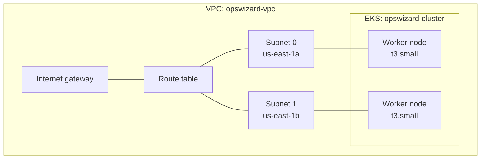

# EKS Configuration with Terraform

Terraform code that provisions an **Amazon EKS cluster** in `us-east-1`, including its networking, IAM roles and a managed worker node group.

This cluster is the deployment target for the [Github-Actions_CICD_EKS project](https://github.com/LovethOmah/Github-Actions_CICD_EKS), where a GitHub Actions pipeline builds a Java app and deploys it here with `kubectl`.

---

## What it creates



| Resource | Name |
|---|---|
| VPC | `opswizard-vpc` |
| Subnets (×2, across two availability zones) | `opswizard-subnet-0`, `opswizard-subnet-1` |
| Internet gateway and route table | `opswizard-igw`, `opswizard-route-table` |
| Security groups | `opswizard-cluster-sg`, `opswizard-node-sg` |
| EKS cluster | `opswizard-cluster` |
| Managed node group | `opswizard-node-group`: 2 × `t3.small` |
| IAM roles | `opswizard-cluster-role`, `opswizard-node-group-role`, plus the AWS-managed policies they need |

17 resources in total.

---

## Files

| File | Purpose |
|---|---|
| `main.tf` | Provider (`us-east-1`), networking, security groups, EKS cluster, node group and IAM roles |
| `variables.tf` | `ssh_key_name`: the EC2 key pair attached to the worker nodes |
| `output.tf` | Prints `cluster_id`, `node_group_id`, `subnet_ids` and `vpc_id` after `apply` |

---

## Prerequisites

- An AWS account and an IAM user with permission to create VPC, EC2, IAM and EKS resources
- [Terraform](https://developer.hashicorp.com/terraform/install)
- [AWS CLI v2](https://docs.aws.amazon.com/cli/latest/userguide/getting-started-install.html), configured with `aws configure`
- [kubectl](https://kubernetes.io/docs/tasks/tools/install-kubectl-linux/)
- An **EC2 key pair in the same region** as the cluster

I ran everything from a small Ubuntu EC2 instance (`t3.small`) that acts as the admin server.

---

## Usage

### 1. Set your key pair

Key pairs only exist in one region. In `variables.tf`, set the default to the name of a key pair in `us-east-1`, without the `.pem` extension:

```hcl
variable "ssh_key_name" {
  default = "your-key-pair-name"
}
```

### 2. Create the cluster

```bash
terraform init
terraform plan
terraform apply
```

It takes about 15 minutes: around 7 for the control plane and 3–5 for the node group.

### 3. Connect kubectl

```bash
aws eks update-kubeconfig --region us-east-1 --name opswizard-cluster
kubectl get nodes
```

Both nodes should show `Ready`.

---

## Clean up

EKS is billed by the hour, including the control plane, so destroy the cluster when you're not using it.

If you deployed anything with a `LoadBalancer` service, delete it first. Terraform doesn't know about the load balancer Kubernetes created, and it blocks the VPC from being deleted:

```bash
kubectl delete svc --all            # or: kubectl delete -f ds.yml
terraform destroy
```
